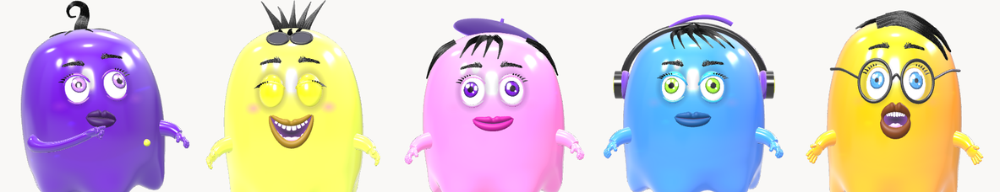
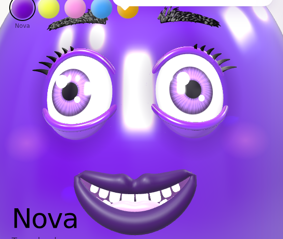
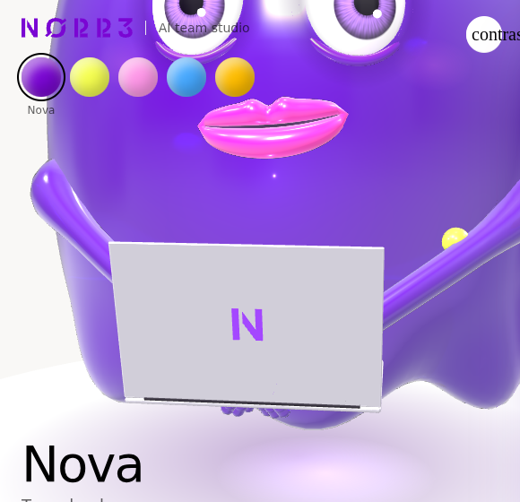

# NØRR3 AI team studio

Five 3D jelly ghost characters for NØRR3's AI employees. Each ghost is a fully rigged web character: 47 named controls, six activity states, eleven emotions, twelve one-shot gestures, chat bubbles, lip sync and a JSON command API that an agent can call.



| Face close-up | Working |
|---|---|
|  |  |

## Run it

No build step. Open `index.html` in a browser, or serve the folder:

```bash
npx serve .
```

three.js r147 and the fonts load from public CDNs. Everything else (geometry, materials, hair, textures) is generated in code, so the file works as one self-contained page.

## The team

| Persona | Role | Colour | Look | Screen while working |
|---|---|---|---|---|
| Nova | Team lead | `#7A06D3` | Black hair curl, lime brand dot | Task board |
| Sunny | Marketing & social | `#F6FF4F` | Black spikes, sunglasses | Social posts |
| Pixel | Design & creative | `#FF97E8` | Felt beret, black bangs | Design canvas |
| Byte | Development | `#46A8FF` | Headphones, black fringe | Code editor |
| Delta | Media & data | `#FFBD00` | Round glasses, black swoop | Charts |

Names, voices and sample lines are placeholders. Each persona has a spec in `personas/` with traits, motion style (energy, blink rate, talk speed, idle quirk), voice settings and a starter system prompt.

## What is rigged

- **Eyes:** white eyeballs with a procedural iris and pupil, catchlights, upper and lower lids, lashes. Gaze moves the iris on the eyeball.
- **Brows, lashes and hair:** strand-based black hair with a Kajiya-Kay hair shader. Brows bend, tilt and raise per side.
- **Mouth:** thick shaped lips with a cupid's bow in a darker shade of the body colour, individual upper and lower teeth, gums, tongue. Teeth and tongue are clipped to the opening with the stencil buffer.
- **Body:** transmissive jelly with an inner core and suspended bubbles, squash and stretch, lean, twist, melt, scalloped hem that flutters, secondary wobble on springs.
- **Hands:** rubber-hose arms with a palm, four three-joint fingers and a thumb. Curl, spread, index point and wrist roll per hand.
- **Props:** laptop with pressable keys, glass screen, live role screen and the NØRR3 N mark on the lid. Hair accessories per persona.

The full list is in [docs/controls.md](docs/controls.md).

## Drive it from code

The page exposes `window.NorrGhost`:

```js
NorrGhost.apply({ state: 'working', emotion: 'focused', status: 'Q4 media plan' })
NorrGhost.apply([{ think: 'Reading the brief' }, { wait: 1500 }, { say: 'Found it!' }])
NorrGhost.play('wave')
NorrGhost.say('Hello team')                    // lip sync from the text
NorrGhost.speakAudio(audioUrl, 'Hello team')   // lip sync from ElevenLabs audio
NorrGhost.set({ mouthSmile: 1, handRPoint: 1 }) // hold raw controls
NorrGhost.release()
NorrGhost.setPersona('byte')
```

## Drive it from an agent

1. Give the model the tool in [`agent/ghost_act.tool.json`](agent/ghost_act.tool.json). It calls `ghost_act` whenever its state changes.
2. Forward each tool call to the page and pass it to `NorrGhost.apply()`. [`agent/bridge-example.mjs`](agent/bridge-example.mjs) is a minimal Node server that does this over server-sent events and fetches the voice from OpenRouter.
3. Map your agent's own events to reactions. Suggested defaults:

| Agent event | Reaction |
|---|---|
| Session starts | `listening`, `wave` |
| Model is reasoning | `thinking`, thought bubble |
| Tool call starts | `working`, status pill with the tool name |
| Tool call ends | `nod` |
| Message streaming | typing dots |
| Message done | `say` with the text and the voice audio |
| Turn done | `idle`, `happy` |
| Error | `sad`, `shake` |
| Idle for 10 minutes | `resting` |

The event names in the bridge are placeholders. Rename them to match the webhook payloads your Hermes agent sends.

## Voice

OpenRouter exposes ElevenLabs text to speech through its SDK. The audio has no word timings, so the mouth follows the sound itself. Keep the OpenRouter key on the server.

```js
import { OpenRouter } from "@openrouter/sdk";
const openRouter = new OpenRouter({ apiKey: process.env.OPENROUTER_API_KEY });
const audio = await openRouter.tts.createSpeech({
  speechRequest: { input: text, model: "elevenlabs/eleven-turbo-v2", voice: voiceId, speed: 1 }
});
```

## Repo layout

```
index.html                 the studio: character engine, controls UI, API
personas/*.json            persona specs
agent/ghost_act.tool.json  tool definition for the model
agent/bridge-example.mjs   example server: agent events to the page, voice from OpenRouter
docs/controls.md           every rig control, state, emotion and gesture
docs/img/                  renders
```

## Brand notes

Colours come from the NØRR3 Brand Guideline 2026. Purple leads; pink, blue and orange are accent colours in the guide, so keep purple dominant in group shots. The lid logo is the official N mark file, extruded, never redrawn.
